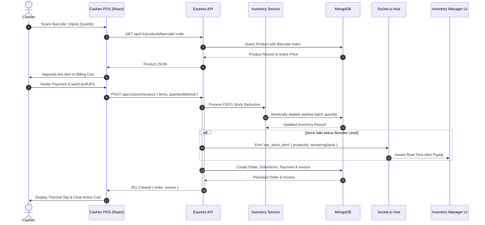

# Architectural Design Specification
## NexCart — Intelligent Supermarket Automation System

### 1. Architectural Philosophy
NexCart adheres to the **Layered Architecture (3-Tier)** design pattern, enforcing strict separation of concerns, decoupling of user interface from business rules, and encapsulation of persistence logic.

```
+-----------------------------------------------------------+
|                     PRESENTATION LAYER                    |
|      React 18 + Vite SPA | Tailwind CSS | Lucide React    |
+-----------------------------------------------------------+
                              |
                     HTTPS / REST API / WSS
                              v
+-----------------------------------------------------------+
|                     APPLICATION LAYER                     |
|  Express.js API Gateway | JWT & RBAC Guards | Controllers  |
|  FEFO Engine | Demand Forecasting | PDF Invoice Generator |
|  Socket.io WebSocket Dispatcher                           |
+-----------------------------------------------------------+
                              |
                    Mongoose ODM (Transactions)
                              v
+-----------------------------------------------------------+
|                        DATA LAYER                         |
|         MongoDB 7.0 Document Store (B-Tree Indexes)       |
+-----------------------------------------------------------+
```

---

### 2. Tier Breakdown

#### 2.1 Presentation Tier (Frontend Client)
- **Framework:** React 18 with Vite build tooling.
- **Styling Engine:** Tailwind CSS with custom design tokens for supermarket management (density-optimized tables, high-contrast POS interfaces, dark slate command consoles).
- **Client State Architecture:**
  - `AuthContext`: Tracks authentication state, token storage, and active role.
  - `CartContext`: Manages client-side cart items, local persistence, and quantity sync.
  - `SocketContext`: Subscribes to real-time notification rooms (`role:inventory_manager`, `role:cashier`, `role:admin`).
- **HTTP Abstraction:** Axios instance configured with request interceptors for automatic JWT injection and response interceptors for global error handling.

#### 2.2 Application Tier (Backend Server)
- **Runtime:** Node.js v25 with Express.js.
- **Middleware Pipeline:**
  1. `helmet`: HTTP headers protection against standard web vulnerabilities.
  2. `cors`: Restricts cross-origin interactions strictly to trusted client origins.
  3. `rateLimiter`: Protects against brute-force attacks and volumetric API abuse.
  4. `authMiddleware`: Cryptographic JWT verification and decoding.
  5. `roleMiddleware`: Principle of least privilege enforcement.
  6. `auditMiddleware`: Logs state changes into `auditLogs` collection.
  7. `errorHandler`: Centralized error normalization.
- **Service Layer Pattern:** Controllers delegate business operations to dedicated domain services:
  - `inventoryService`: Implements First-Expired First-Out (FEFO) batch consumption and stock reservation.
  - `markdownService`: Dynamically determines discount percentages based on batch expiry proximity.
  - `forecastService`: Computes moving-average demand models from historical sales velocity.
  - `pdfInvoiceService`: Server-side PDF invoice compilation via PDFKit.

#### 2.3 Data Tier (Persistence Layer)
- **Database Engine:** MongoDB 7.0.
- **Object Data Modeling:** Mongoose with strictly typed schemas.
- **Indexing Strategy:**
  - `products.barcode`: Unique sparse index for rapid scanner lookup.
  - `products.sku`: Unique index for catalog SKU resolution.
  - `inventory.productId`: Unique index ensuring 1:1 inventory mapping.
  - `orders.createdAt`: Descending index for rapid time-series analytics and pagination.

---

### 3. Data Flow Diagram (Level 1: POS Checkout Transaction)


