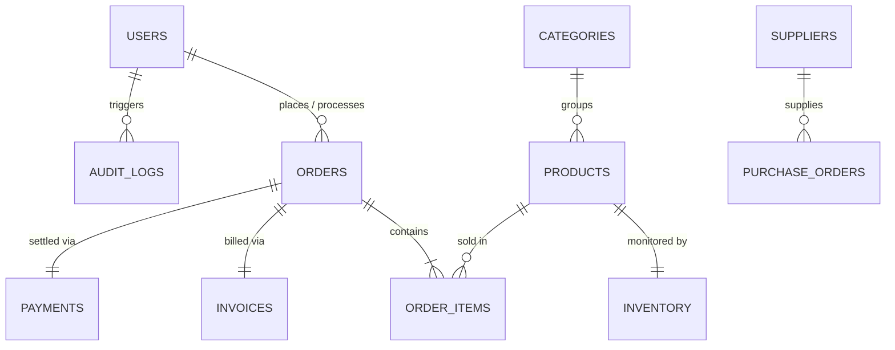

# Database Schema & Data Dictionary
## NexCart — Intelligent Supermarket Automation System

### 1. Database Overview
- **Database Engine:** MongoDB 7.0 Community Edition
- **Object Data Modeling (ODM):** Mongoose v8.9.2
- **Connection URI:** `mongodb://127.0.0.1:27017/nexcart_db`
- **Design Philosophy:** Hybrid normalization. Core entities are cleanly partitioned across 15 collections, with embedded subdocuments for high-locality sub-entities (e.g. `batches` inside `inventory`, `itemsSnapshot` in `invoices`).

---

### 2. Entity Relational Mapping (ERD)

---

### 3. Collection Specifications

#### 3.1 `users`
| Field | Type | Modifiers | Description |
|---|---|---|---|
| `_id` | ObjectId | Primary Key | Unique user identifier |
| `name` | String | Required, Trim | Full user name |
| `email` | String | Required, Unique, Lowercase | User email address |
| `passwordHash` | String | Required | Bcrypt salted hash (cost: 10) |
| `role` | String | Enum: customer, cashier, inventory_manager, admin | Authorization role |
| `phone` | String | Optional | Contact phone number |
| `status` | String | Enum: active, inactive | Account status |
| `lastLogin` | Date | Optional | Timestamp of last authentication |
| `createdAt` / `updatedAt` | Date | Timestamps | System timestamps |

#### 3.2 `products`
| Field | Type | Modifiers | Description |
|---|---|---|---|
| `_id` | ObjectId | Primary Key | Unique product identifier |
| `barcode` | String | Required, Unique, Indexed | EAN/UPC barcode string |
| `sku` | String | Required, Unique, Indexed | Stock Keeping Unit identifier |
| `name` | String | Required, Trim | Product display title |
| `description` | String | Optional | Detailed product specifications |
| `categoryId` | ObjectId | Ref: Category, Indexed | Parent category reference |
| `brand` | String | Optional | Manufacturer / Brand name |
| `unit` | String | Enum: kg, g, litre, ml, pcs, pack | Measurement unit |
| `costPrice` | Number | Required, Min: 0 | Wholesale acquisition cost |
| `sellingPrice` | Number | Required, Min: 0 | Retail shelf price |
| `taxRate` | Number | Default: 5.0 | GST/Sales tax percentage |
| `imageUrl` | String | Optional | Product image asset path |
| `isExpiryTracked` | Boolean | Default: true | Flags perishable items for FEFO |
| `isActive` | Boolean | Default: true | Catalog visibility flag |

#### 3.3 `inventory`
| Field | Type | Modifiers | Description |
|---|---|---|---|
| `_id` | ObjectId | Primary Key | Unique inventory record identifier |
| `productId` | ObjectId | Ref: Product, Unique, Indexed | Associated product reference |
| `totalStock` | Number | Required, Min: 0 | Aggregate on-hand quantity |
| `reorderLevel` | Number | Required, Default: 10 | Threshold triggering low-stock alert |
| `optimalStock` | Number | Required, Default: 50 | Target replenishment target level |
| `shelfLocation` | String | Optional | Physical location (e.g. "Aisle 4, Bay 2") |
| `batches` | Array | Subdocument Array | FEFO batches (`batchNumber`, `quantity`, `expiryDate`, `costPrice`, `receivedDate`) |
| `lastAuditedAt` | Date | Optional | Timestamp of last physical audit |

#### 3.4 `orders`
| Field | Type | Modifiers | Description |
|---|---|---|---|
| `_id` | ObjectId | Primary Key | Unique order identifier |
| `orderNumber` | String | Required, Unique, Indexed | Human-readable identifier (e.g. "NXC-2026-0001") |
| `orderType` | String | Enum: online, pos_walkin, self_checkout | Transaction origin |
| `customerId` | ObjectId | Ref: User, Optional | Customer account (null for anonymous walk-in) |
| `cashierId` | ObjectId | Ref: User, Optional | Processing cashier (for POS) |
| `subtotal` | Number | Required | Base price before discounts and taxes |
| `discountTotal`| Number | Default: 0 | Applied promotion deductions |
| `taxTotal` | Number | Required | Total calculated sales tax |
| `totalAmount` | Number | Required | Final payable amount |
| `paymentStatus`| String | Enum: pending, paid, failed, refunded | Payment settlement status |
| `orderStatus` | String | Enum: pending, processing, completed, cancelled | Fulfillment status |

#### 3.5 `auditLogs`
| Field | Type | Modifiers | Description |
|---|---|---|---|
| `_id` | ObjectId | Primary Key | Immutable log identifier |
| `userId` | ObjectId | Ref: User, Indexed | Actor triggering operation |
| `action` | String | Required | Semantic action (e.g. "STOCK_ADJUSTMENT") |
| `module` | String | Required, Indexed | Target domain ("inventory", "products", etc.) |
| `recordId` | String | Indexed | Modified entity ID |
| `ipAddress` | String | Optional | Request origin IP |
| `previousState`| Object | Mixed | JSON diff before modification |
| `newState` | Object | Mixed | JSON diff after modification |
| `timestamp` | Date | Default: Date.now, Indexed | Audit event timestamp |
